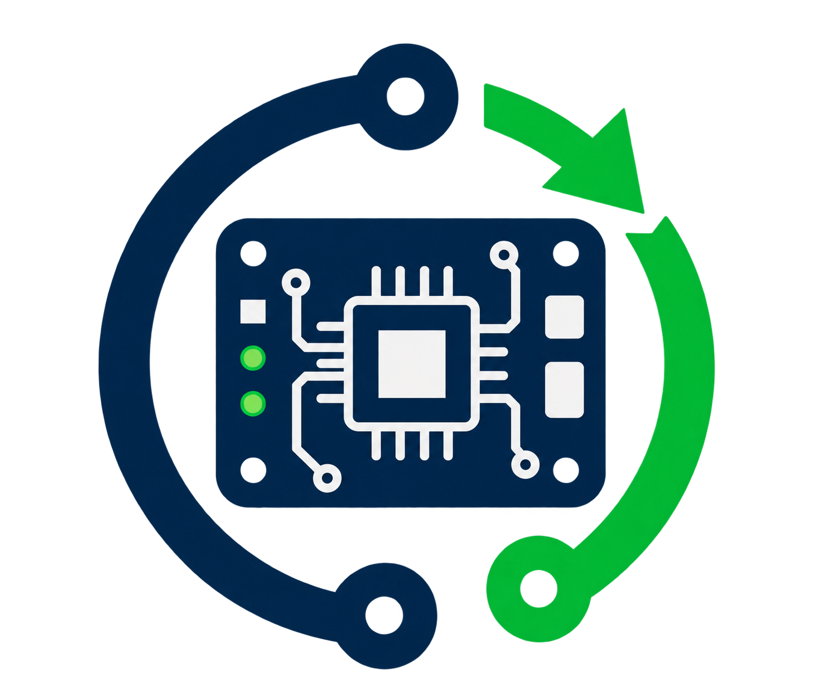

# meta-labautomation

Yocto layer for lab test automation.



## Build

```sh
kas build kas/kas-labautomation.yml
```

## Run in Qemu

```sh
kas shell kas/kas-labautomation.yml \
    -c 'runqemu kvm serialstdio nographic snapshot'
```
