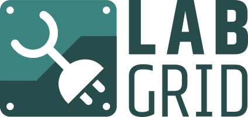
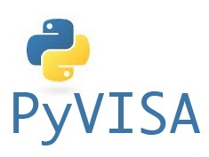

# meta-labautomation

OpenEmbedded/Yocto layer for building a Linux controller for embedded testing labs. It brings together tools to flash boards, control power, access serial consoles, work with test instruments and run automated tests.

It includes Robot Framework, CI runners and agents, container services and MCP servers. The MCP servers enable AI automation by connecting AI assistants to lab tools for device control, serial communication and test execution. Optional Labgrid integration adds shared device control and a web dashboard. Packages are grouped by purpose so you can choose what your lab needs.


## Included tools

<!-- Labgrid and PyVISA logos come from their projects, other logos from https://simpleicons.org -->
<table>
  <tr>
    <td align="center"><a href="https://labgrid.readthedocs.io/"><br>Labgrid</a></td>
    <td align="center"><a href="https://robotframework.org/"><br>Robot Framework</a></td>
    <td align="center"><a href="https://www.docker.com/"><br>Docker</a></td>
    <td align="center"><a href="https://www.jenkins.io/"><br>Jenkins agent</a></td>
    <td align="center"><a href="https://about.gitlab.com/"><br>GitLab Runner</a></td>
    <td align="center"><a href="https://github.com/"><br>GitHub Actions runner</a></td>
    <td align="center"><a href="https://modelcontextprotocol.io/"><br>MCP</a></td>
    <td align="center"><a href="https://pyvisa.readthedocs.io/"><br>PyVISA</a></td>
  </tr>
</table>

## Build

### QEMU

Build for `qemux86-64`:

```sh
kas build kas/kas-labautomation.yml
```

Run in QEMU:

```sh
kas shell kas/kas-labautomation.yml \
    -c 'runqemu kvm serialstdio nographic snapshot'
```

### Hardware

Replace `<MACHINE>` with your board's Yocto machine name. Its BSP layer must be included in the kas configuration.

```sh
KAS_MACHINE='<MACHINE>' kas build kas/kas-labautomation.yml
```

For Raspberry Pi 5, use the provided configuration:

```sh
kas build kas/kas-labautomation-rpi.yml
```

### Secure Raspberry Pi

The secure build uses [meta-raspberrypi-secure](https://github.com/embetrix/meta-raspberrypi-secure) for boot signing, secure storage and SWUpdate bundles. It defaults to Raspberry Pi 5 and the `dev` security profile.

Follow that layer's signing key setup and save the generated kas fragment as `kas/kas-signing-keys.yml`, then build:

```sh
KAS_MACHINE=raspberrypi5 SECURITY_PROFILE=dev \
    kas build kas/kas-labautomation-rpi-secure.yml:kas/kas-signing-keys.yml
```
