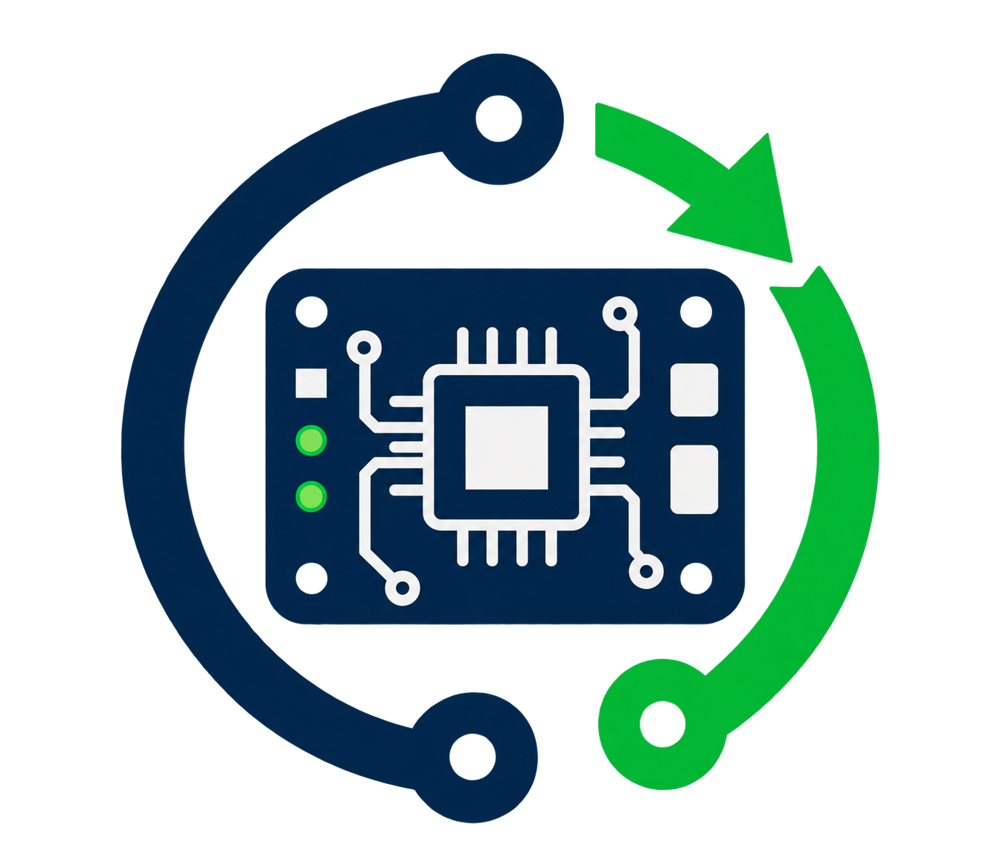
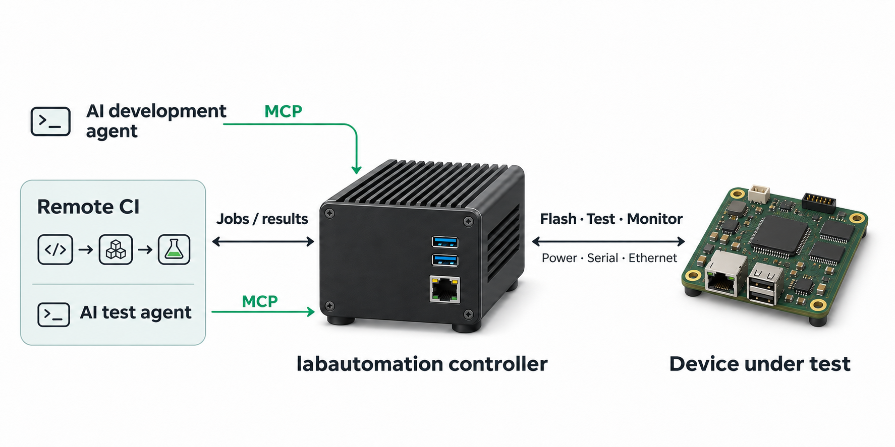

# meta-labautomation
[](https://github.com/embetrix/meta-labautomation/actions/workflows/bitbake-parse.yml?query=branch%3Awrynose)
[](LICENSE)



OpenEmbedded/Yocto layer for building a Linux controller for lab automation and hardware-in-the-loop (HIL) testing.

## Use cases

- Automated board flashing and testing
- Hardware-in-the-loop (HIL) testing
- CI/CD pipelines with real hardware
- Remote lab access and device control
- Embedded device security testing
- AI-assisted lab automation



## Supported tools and frameworks

<table>
  <thead>
    <tr><th>Category</th><th>Selected tools</th></tr>
  </thead>
  <tbody>
    <tr>
      <td>Test automation</td>
      <td>
        <a href="https://robotframework.org/">Robot Framework</a> ·
        <a href="https://labgrid.readthedocs.io/">Labgrid</a>
      </td>
    </tr>
    <tr>
      <td>Flashing and debugging</td>
      <td>
        <a href="https://github.com/nxp-imx/mfgtools">UUU</a> ·
        <a href="https://sourceforge.net/projects/stm32flash/">stm32flash</a> ·
        <a href="https://github.com/bootlin/snagboot">Snagboot</a> ·
        <a href="https://github.com/linux-automation/usbsdmux">usbsdmux</a> ·
        <a href="https://openocd.org/">OpenOCD</a>
      </td>
    </tr>
    <tr>
      <td>Power control</td>
      <td>
        <a href="https://www.shelly.com/collections/smart-plugs">Shelly</a> ·
        <a href="https://fritz.com/en/collections/smart-home">FRITZ!Box</a> ·
        <a href="https://github.com/prevas-dk/labgrid-powerrelay">GPIO relays</a>
      </td>
    </tr>
    <tr>
      <td>Test instruments</td>
      <td>
        <a href="https://pyvisa.readthedocs.io/">PyVISA</a>
      </td>
    </tr>
    <tr>
      <td>Industrial protocols</td>
      <td>
        <a href="https://www.can-cia.org/">CAN</a> ·
        <a href="https://www.modbus.org/">Modbus</a> ·
        <a href="https://opcfoundation.org/about/opc-technologies/opc-ua/">OPC UA</a> ·
        <a href="https://mqtt.org/">MQTT</a> ·
        <a href="https://zeromq.org/">ZeroMQ</a>
      </td>
    </tr>
    <tr>
      <td>Penetration testing</td>
      <td>
        <a href="https://nmap.org/">Nmap</a> ·
        <a href="https://scapy.net/">Scapy</a> ·
        <a href="https://www.tcpdump.org/">tcpdump</a> ·
        <a href="https://github.com/Ettercap/ettercap">Ettercap</a> ·
        <a href="https://tcpreplay.appneta.com/">tcpreplay</a>
      </td>
    </tr>
    <tr>
      <td>VPN</td>
      <td>
        <a href="https://openvpn.net/">OpenVPN</a> ·
        <a href="https://tailscale.com/">Tailscale</a> ·
        <a href="https://www.wireguard.com/">WireGuard</a>
      </td>
    </tr>
    <tr>
      <td>CI and containers</td>
      <td>
        <a href="https://www.jenkins.io/">Jenkins agent</a> ·
        <a href="https://about.gitlab.com/">GitLab runner</a> ·
        <a href="https://github.com/actions/runner">GitHub Actions runner</a> ·
        <a href="https://www.docker.com/">Docker</a>
      </td>
    </tr>
    <tr>
      <td>AI automation</td>
      <td>
        <a href="https://modelcontextprotocol.io/">MCP</a>
      </td>
    </tr>
  </tbody>
</table>

## Build

### QEMU

Build for `qemux86-64`:

```sh
kas build kas/kas-labautomation.yml
```

Run in QEMU:

```sh
kas shell kas/kas-labautomation.yml \
    -c 'runqemu kvm serialstdio nographic snapshot'
```

### Hardware

Replace `<MACHINE>` with your board's Yocto machine name. Its BSP layer must be included in the kas configuration.

```sh
KAS_MACHINE='<MACHINE>' kas build kas/kas-labautomation.yml
```

For Raspberry Pi 4/5, use the provided configuration:

```sh
kas build kas/kas-labautomation-rpi.yml
```

### Image output and flashing

Images are saved in `build/tmp/deploy/images/<MACHINE>/`. Flash the Raspberry Pi 5 image with bmaptool:

```sh
sudo bmaptool copy \
    build/tmp/deploy/images/raspberrypi5/labautomation-image-raspberrypi5.rootfs.wic.bz2 \
    /dev/sdX
```

Keep the matching `.wic.bmap` beside the image. Unmount the target partitions and replace `/dev/sdX` with the whole target device. This overwrites the drive.

## Disclaimer

This project is provided "as is", without warranty. See [LICENSE](LICENSE) for details. Included third-party software has its own licenses.

Third-party names, logos and trademarks belong to their respective owners. Their use here identifies supported tools and does not imply endorsement or affiliation.

## Commercial support

For commercial support with different hardware platforms, custom development, CI/CD integration, AI agents, automated testing, security and penetration testing, contact Embetrix Embedded Systems Solutions at [info@embetrix.com](mailto:info@embetrix.com).
